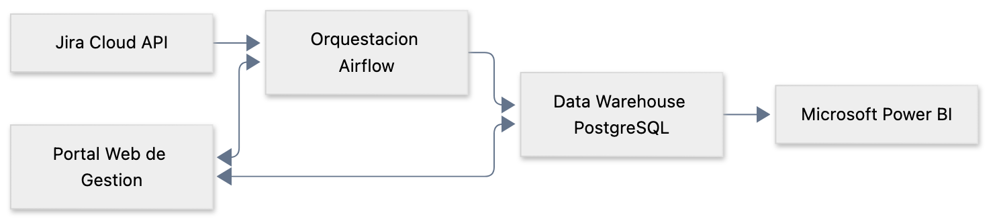
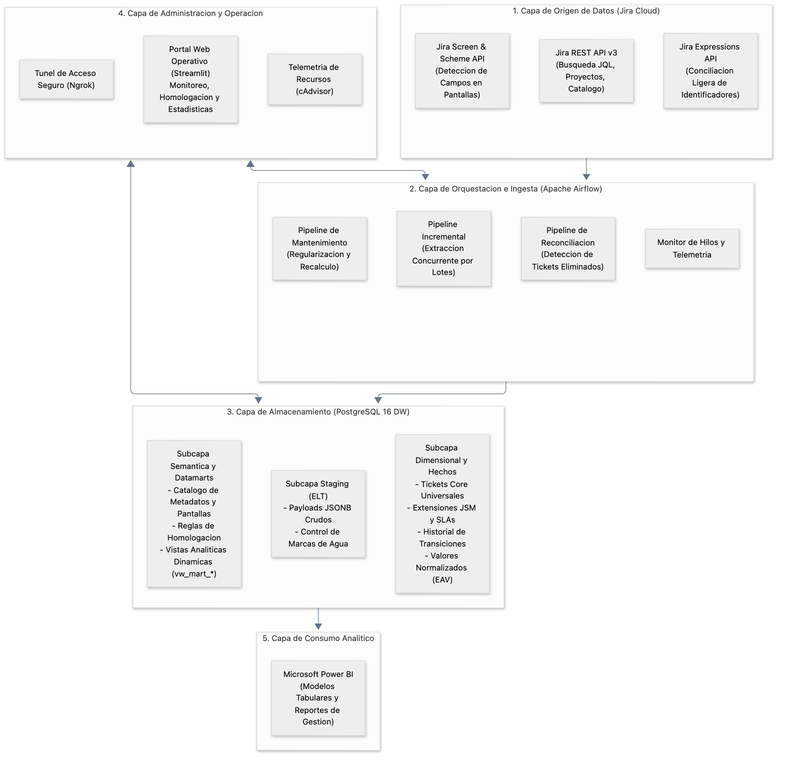
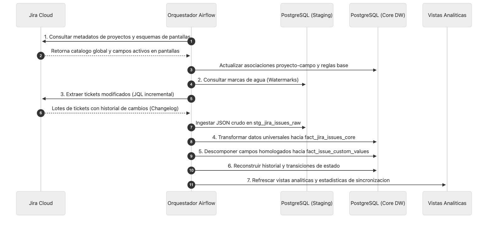
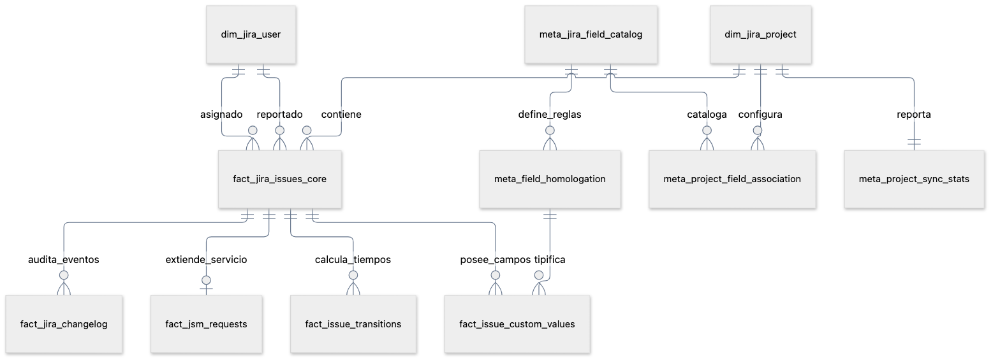
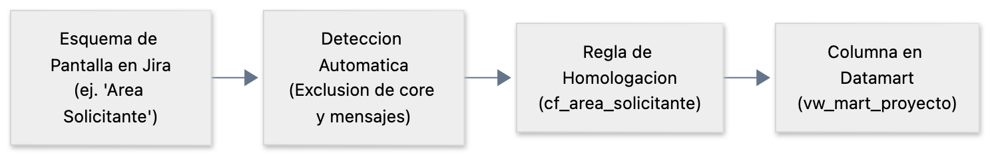

# Plataforma de Gobierno y Analítica de Datos Jira Cloud
## Especificación Funcional y Arquitectura de la Solución

**Organización:** Gobierno TI - Integratel Perú  
**Entorno Origen:** Atlassian Jira Cloud (`integratelperu.atlassian.net`)  
**Alcance Analítico:** Más de 120 espacios de trabajo activos (Jira Software, Jira Service Management y Jira Work Management), con una volumetría histórica superior a 1.1 millones de tickets y 19 millones de eventos de auditoría (changelog).  
**Destino de Exposición:** Data Warehouse Analítico y Dashboards en Microsoft Power BI.

---

## 1. Resumen Ejecutivo y Objetivos de Negocio

El proyecto implementa una plataforma centralizada de datos diseñada para desacoplar el análisis operativo y estratégico de la API de Atlassian Jira Cloud. La solución extrae periódicamente la actividad de los espacios de trabajo, estructura la información en un almacén analítico relacional y la expone mediante vistas optimizadas para el consumo en herramientas de Inteligencia de Negocios.



### Objetivos Estratégicos
1. **Desacoplamiento y Rendimiento:** Reemplazar el consumo directo de APIs o consultas pesadas sobre el sistema transaccional mediante un repositorio analítico local en PostgreSQL 16 con cálculos precomputados de tiempos de ciclo (*Lead Time*, *Cycle Time*) y duraciones en estados.
2. **Gobierno y Normalización de Campos:** Administrar la heterogeneidad de campos personalizados creados en más de 120 proyectos sin generar dispersión de datos (*sparse tables*) con columnas nulas masivas.
3. **Eficiencia en Ingesta:** Ejecutar sincronizaciones incrementales basadas en marcas de agua temporales (*watermarks*) y conciliar eliminaciones masivas mediante consultas ligeras de identificadores con Jira Expressions.
4. **Regularización Histórica sin Consumo de API (*Zero-API Backfill*):** Conservar los registros en bruto en una capa de almacenamiento intermedio (*Staging* JSONB) para habilitar nuevos campos o corregir métricas históricas de forma retroactiva sin volver a consultar a Atlassian.
5. **Operatividad y Seguimiento Diario:** Facilitar un portal web administrativo para el equipo de Gobierno TI que permita auditar la extracción en tiempo real, homologar esquemas y supervisar estadísticas operativas sin requerir intervención en línea de comandos.

---

## 2. Arquitectura Global de la Solución

La plataforma opera en una arquitectura por capas completamente contenerizada bajo Docker, asegurando independencia del entorno operativo y control estricto del consumo de recursos de cómputo y memoria.

### 2.1. Diagrama de Arquitectura por Capas



### 2.2. Descripción de Componentes

* **Capa de Origen (Atlassian Jira Cloud):** Provee los datos transaccionales mediante servicios REST asegurados por tokens de servicio. Emplea endpoints especializados para esquemas de pantalla, consulta paginada de incidencias y expresiones evaluadas en el servidor de Atlassian para extraer lotes masivos de IDs.
* **Capa de Orquestación (Apache Airflow):** Gestiona los flujos de trabajo programados con un ejecutor local multi-proceso (`LocalExecutor`). Coordina la extracción diferencial en paralelo mediante un modelo de productores concurrentes y un consumidor unificado hacia la base de datos.
* **Capa de Almacenamiento (Data Warehouse PostgreSQL 16):** Repositorio relacional central optimizado con extensiones de indexación avanzada (árboles B y GIN sobre JSONB) y segmento de memoria compartida ampliado para procesamiento analítico de alto volumen.
* **Capa de Operación (Portal Web Streamlit):** Interfaz gráfica corporativa para seguimiento de estado, auditoría de hilos de extracción, control de proyectos activos/pausados y administración de reglas de negocio.
* **Capa de Consumo (Power BI):** Acceso nativo SQL a vistas relacionales desnormalizadas donde cada ticket expone sus campos estándar y específicos como columnas directas, eliminando la complejidad del modelo subyacente.

---

## 3. Flujos Funcionales de Datos

### 3.1. Proceso de Sincronización Incremental



1. **Sincronización de Metadatos y Pantallas:** Se cataloga la totalidad de campos de la instancia y se mapean los esquemas de pantalla asignados a cada proyecto activo, descartando campos técnicos o decorativos irrelevantes.
2. **Lectura de Marcas de Agua:** Se identifica la fecha y hora del último ticket sincronizado por proyecto para formular consultas JQL incrementales restringidas a registros modificados recientemente.
3. **Extracción Paralela:** Hilos de trabajo concurrentes solicitan los lotes de datos y su historial de modificaciones a la API de Jira, mitigando los tiempos de respuesta y respetando los límites de tasa de peticiones.
4. **Carga en Staging:** El contenido íntegro se preserva en formato JSONB con trazabilidad de fechas de ingesta y claves únicas inmutables.
5. **Transformación Dimensional:** Se extraen los atributos universales (resumen, estado, tipo, jerarquías, reportero, asignado, fechas clave) poblando el hecho principal.
6. **Normalización EAV y Homologación:** Los campos personalizados asociados a pantallas se procesan según su naturaleza de dato (texto, numérico, fechas, selección en cascada o usuario) y se almacenan en una estructura Entidad-Atributo-Valor tipada.
7. **Línea de Tiempo de Transiciones:** Se recalculan las duraciones de permanencia en cada estado y los tiempos de ciclo para alimentar indicadores de flujo y eficiencia.
8. **Actualización de Vistas:** Se actualizan las vistas del Datamart para reflejar los nuevos campos sin alterar la estructura física de las tablas base.

### 3.2. Conciliación y Detección de Tickets Eliminados

Dado que la API REST de Jira no emite eventos automáticos cuando un registro es eliminado físicamente en la interfaz web, el sistema incorpora un flujo de auditoría ligera:

* **Mecanismo:** Utiliza la API de Jira Expressions para recuperar exclusivamente los identificadores numéricos (`issue_id`) de todos los tickets existentes en cada proyecto mediante una única petición compacta.
* **Conciliación:** Se compara el conjunto de identificadores devueltos contra las claves almacenadas en el Data Warehouse.
* **Borrado Lógico:** Aquellos registros ausentes en la respuesta de Jira se marcan con bandera de eliminación lógica (`is_deleted = TRUE`) registrando la marca de tiempo de detección, lo cual preserva la integridad del historial analítico sin alterar métricas activas.

### 3.3. Regularización Histórica sin Consumo de API (*Zero-API Backfill*)

Cuando una unidad de negocio requiere incorporar un campo personalizado preexistente que no formaba parte del reporte inicial:

* El campo se activa mediante el portal web o la asociación de pantallas.
* Un procedimiento interno de base de datos lee directamente los documentos JSONB almacenados en la capa de *Staging*.
* La información histórica se extrae y se traslada a la tabla dimensional en cuestión de segundos, sin realizar llamadas adicionales a la API de Jira Cloud ni impactar las cuotas de red corporativas.

---

## 4. Arquitectura de Información y Modelo de Datos

El diseño del Data Warehouse sigue un enfoque dimensional estructurado para garantizar consistencia, integridad referencial y alta velocidad de consulta.



### 4.1. Principios de Integridad y Persistencia

1. **Claves Primarias Inmutables:** Los identificadores de negocio de Jira (`issue_key` como `TI-101` o `project_key` como `TI`) son mutables, ya que un administrador puede renombrar el prefijo de un proyecto o mover una incidencia entre proyectos. Por esta razón, todas las relaciones de integridad referencial se basan en los identificadores numéricos internos inmutables de Jira (`issue_id` y `project_id`).
2. **Normalización Híbrida (Core + EAV):**
   * **Atributos Universales:** Campos compartidos por el 100% de los proyectos (resumen, estado, tipo de incidencia, nivel de jerarquía, creador, asignado, fechas de creación/resolución) residen en columnas dedicadas en la tabla principal.
   * **Atributos Específicos:** Campos propios de proyectos o tipologías particulares se almacenan en una matriz EAV (*Entity-Attribute-Value*) tipada, evitando la proliferación de tablas con cientos de columnas nulas.
3. **Estandarización de Nomenclatura:** Los campos personalizados adoptan de forma unificada el prefijo `cf_` seguido de su nombre canónico en minúsculas y sin caracteres especiales (por ejemplo: `cf_area_cliente`, `cf_moneda`, `cf_prioridad`).

### 4.2. Entidades Principales del Data Warehouse

| Entidad | Tipo | Propósito y Contenido Funcional |
| :--- | :--- | :--- |
| `dim_jira_project` | Dimensión | Maestro de espacios de trabajo, tipo de proyecto (software, servicio, negocio), estado de sincronización y control de cambios de prefijo. |
| `dim_jira_user` | Dimensión | Directorio unificado de usuarios (responsables, solicitantes, aprobadores) con nombres para mostrar, correos y estado en Atlassian. |
| `fact_jira_issues_core` | Hecho Principal | Tabla central de incidencias. Contiene datos universales, niveles de jerarquía (subtarea, estándar, épica), fechas clave, métricas de tiempo global y bandera de borrado lógico. |
| `fact_jsm_requests` | Extensión | Hecho complementario exclusivo para Jira Service Management. Contiene tipos de solicitud del portal, organizaciones de clientes, cumplimiento de SLAs y encuestas de satisfacción. |
| `fact_issue_custom_values` | Hecho EAV | Valores normalizados de campos personalizados por ticket. Almacena representaciones tipadas (texto, numérico, fecha o usuario) sin redundancia. |
| `fact_jira_changelog` | Auditoría | Registro histórico detallado de todas las modificaciones realizadas en los campos de las incidencias (valores anteriores y posteriores, autores y marcas de tiempo). |
| `fact_issue_transitions` | Analítico | Tabla de eventos precomputados que registra cada estado por el que transitó una incidencia, su secuencia cronológica y la duración exacta en segundos. |
| `meta_jira_field_catalog` | Metadatos | Catálogo de la totalidad de campos existentes en la instancia de Jira Cloud, identificando tipos de esquema y proveedores de campos. |
| `meta_project_field_association` | Metadatos | Registro de los campos efectivamente asociados a las pantallas y esquemas de cada proyecto en Jira. |
| `meta_field_homologation` | Metadatos | Reglas de negocio que definen qué campos se incorporan al Datamart, su nombre analítico estandarizado y su estrategia de conversión. |
| `meta_project_sync_stats` | Métricas | Resumen precalculado por espacio que expone volumen de tickets, campos en pantalla, campos homologados y estado de sincronización para consulta inmediata. |

---

## 5. Estrategia de Homologación de Campos Personalizados

Dado que cada espacio de Jira puede configurar formularios y campos de manera independiente, el sistema aplica una estrategia automatizada de homologación:



### 5.1. Criterios de Selección y Filtrado
* **Detección por Pantallas:** El motor consulta la jerarquía de esquemas de pantalla asignados a los tipos de incidencia de cada proyecto. Únicamente los campos habilitados visualmente en Jira se consideran candidatos a homologación.
* **Exclusión de Campos Redundantes:** Se descartan de forma automática los campos del core estándar (que ya pertenecen a la tabla universal) y campos informativos de solo lectura de tipo mensaje corporativo.

### 5.2. Estrategias de Normalización

* **Campos de Texto y Selección Simple (`STRING`):** Se limpian espacios en blanco y se preserva el valor textual seleccionado o ingresado.
* **Campos Numéricos (`NUMBER`):** Se valida el formato y se almacena en columna de alta precisión para operaciones cuantitativas en Power BI.
* **Campos Temporales (`DATE`):** Se normalizan hacia marcas de tiempo con zona horaria estandarizada (`America/Lima`).
* **Selección en Cascada (`CASCADE_SPLIT`):** Aquellos campos con estructura jerárquica (padre e hijo) se subdividen automáticamente en dos atributos analíticos independientes: `cf_<campo>_parent` y `cf_<campo>_child`.
* **Selectores de Usuario (`USER_DIM`):** El usuario se incorpora a la dimensión de usuarios del Data Warehouse y en el hecho analítico se almacena tanto su nombre para mostrar como su identificador de cuenta para cruces analíticos.

---

## 6. Portal de Gestión y Administración Operativa

La plataforma dispone de una consola web diseñada para el equipo de Gobierno TI y soporte operativo, accesible internamente y expuesta de forma segura para reuniones de seguimiento diario (*dailys*).

### 6.1. Capacidades Funcionales del Portal

1. **Panel General de Sincronización:**
   * Indicadores clave de rendimiento: estado general del servicio, cantidad de espacios activos, volumen total de tickets en almacén y total de eventos de auditoría registrados.
   * **Monitor de Hilos en Tiempo Real:** Visualización en vivo del estado de los productores de extracción de Jira Cloud y del hilo consumidor de base de datos, reportando lotes en cola, volumen extraído y marcas de tiempo de actividad.
   * **Tabla Maestra de Proyectos:** Matriz de control con filtros por estado y buscador por código/nombre. Expone de manera diferenciada los **Campos en Pantalla** detectados en Jira frente a los **Campos Homologados** incorporados al Data Warehouse.
   * Control de proyectos para activar o pausar la sincronización programada individual o masivamente.
2. **Homologación de Campos:**
   * **Acciones Masivas en Un Clic:** Botones de auto-mapeo para generar de forma inmediata las reglas base de todos los espacios activos, y regularización secuencial del histórico sin requerir scripts manuales.
   * **Visor Tabular de Reglas:** Módulo de auditoría que permite filtrar por proyecto las reglas activas, verificando nombres analíticos de columna, estrategias y presencia en Datamart.
   * **Mapeo Manual Avanzado:** Formulario individual para incorporar casos atípicos o forzar comportamientos específicos.
3. **Explorador del Modelo de Datos (ER):**
   * Consulta instantánea de volumen de registros en vivo por cada tabla física.
   * Diagrama relacional interactivo de la arquitectura de base de datos.
4. **Mantenimiento y Auditoría:**
   * Diagnóstico de marcas de agua por proyecto, tiempos de ejecución y registro de bitácoras operativas.

---

## 7. Infraestructura, Despliegue y Resiliencia

El ecosistema opera mediante una arquitectura de microservicios contenerizados sobre Docker, optimizada para servidores con recursos acotados (mínimo 4 GB RAM, recomendado 8 GB RAM).

### 7.1. Matriz de Servicios y Distribución de Recursos

| Servicio | Rol Arquitectónico | Política de Recursos |
| :--- | :--- | :--- |
| `postgres-dw` | Motor de Data Warehouse Analítico (PostgreSQL 16). | Memoria compartida asignada en 512 MB para acelerar operaciones de agregación y joins analíticos sobre JSONB. |
| `postgres-airflow` | Almacén de metadatos internos del planificador. | Consumo ligero restringido a la gestión de estados de tareas. |
| `airflow-scheduler` | Motor planificador y ejecutor de pipelines (`LocalExecutor`). | Procesamiento multi-hilo acotado para evitar sobrecarga de CPU. |
| `airflow-webserver` | Servidor web y API REST de Airflow. | Interfaz de supervisión técnica de flujos de trabajo. |
| `etl-admin-ui` | Portal web de soporte y seguimiento operativo (Streamlit). | Arquitectura ligera con caché transaccional de 15 segundos y bajo consumo de memoria (<100 MB). |
| `cadvisor` | Recolector de telemetría de rendimiento de contenedores. | Supervisión de uso de CPU y memoria de la infraestructura. |
| `ngrok-tunnel` | Punto de enlace seguro para acceso externo a la UI. | Túnel HTTPS autenticado con credenciales básicas para acceso remoto. |

### 7.2. Mecanismos de Resiliencia y Seguridad

* **Aislamiento en Redes Privadas:** Toda la comunicación entre los componentes de base de datos, orquestación y portal transcurre en una red virtual interna de Docker, exponiendo hacia el exterior únicamente los puertos estrictamente necesarios.
* **Seguridad de Acceso:** La exposición del portal hacia redes externas mediante el túnel seguro requiere autenticación obligatoria y encriptación TLS de extremo a extremo.
* **Protección ante Fallos de Conexión:** Las consultas hacia Jira Cloud implementan políticas de reintento automático con retroceso exponencial (*exponential backoff*) y captura estructurada de códigos HTTP 429 (límite de tasa) y 404/403 (permisos restringidos).
* **Alertas Operativas:** El sistema cuenta con mecanismos de notificación inmediata mediante webhooks para alertar al equipo ante excepciones no controladas en cualquiera de los pipelines.

---

## 8. Guía Operativa de Mantenimiento

### 8.1. Periodicidad Recomendada de Procesos

* **Extracción Incremental:** Ejecución automática cada 15 a 30 minutos a través del orquestador Airflow para mantener la información analítica actualizada con respecto a la operativa diaria.
* **Conciliación de Eliminaciones:** Ejecución diaria nocturna o fuera de horario pico para contrastar el inventario de identificadores y asentar bajas de registros.
* **Auto-Mapeo de Nuevos Proyectos:** Ejecutable bajo demanda desde el portal web al crear o reconfigurar espacios de trabajo en Jira Cloud.
* **Mantenimiento de Base de Datos:** Ejecución semanal de estadísticas analíticas (`VACUUM ANALYZE`) para optimizar los planes de ejecución del motor PostgreSQL.

### 8.2. Diagnóstico Rápido de Estado

Para verificar la continuidad operativa del servicio, el equipo de soporte debe validar:
1. **Estado del Almacén:** Conectividad al puerto del Data Warehouse y estabilidad de volumen de registros en la vista general.
2. **Monitoreo de Hilos:** Ausencia de hilos bloqueados en el panel de telemetría en tiempo real del portal web.
3. **Marcas de Agua:** Que la diferencia de tiempo entre la última sincronización exitosa y la hora actual se mantenga dentro de la ventana de ejecución programada.

---

## 9. Manual de Operaciones y Despliegue (Runbook)

Este manual técnico detalla los procedimientos de encendido, apagado, supervisión y puesta en marcha inicial de la plataforma, tanto en estaciones de trabajo locales (laptop de desarrollo/operación) como en servidores empresariales (Windows Server o Linux).

### 9.1. Operación Cotidiana en Estación de Trabajo Local

#### A. Verificación del Estado de la Plataforma
Para comprobar si los servicios se encuentran en ejecución o detenidos, ejecute en la terminal dentro del directorio del proyecto:

```bash
docker compose ps
```

* **Estado [ACTIVO]:** Los contenedores muestran `Up` o `Up (healthy)`.
* **Estado [DETENIDO]:** No figuran procesos o se listan con estado `Exited`.

#### B. Procedimiento de Encendido (Arranque)
Si la plataforma está apagada (por reinicio de la máquina, cierre de Docker Desktop o detención previa de contenedores):

```bash
# 1. Asegúrese de que la aplicación Docker Desktop se encuentre iniciada en el sistema.
# 2. Inicie todos los microservicios en segundo plano:
docker compose up -d
```

El parámetro `-d` (*detached*) asegura que los contenedores operen como servicios en segundo plano, liberando la consola.

#### C. Procedimiento de Apagado Seguro
Para suspender o apagar los servicios sin perder información:

```bash
# Opción 1: Pausar contenedores (mantiene el estado en memoria para un encendido instantáneo):
docker compose stop

# Opción 2: Detener y desmontar contenedores (los datos persisten intactos en los volúmenes de PostgreSQL):
docker compose down
```

> **Nota de Persistencia:** Los datos analíticos (`jira_dw_vol`) y los metadatos de Airflow (`airflow_metadb_vol`) están alojados en volúmenes gestionados independientes de los contenedores. Ejecutar `docker compose down` o apagar el equipo no destruye la información almacenada.

#### D. Reinicio de Servicios Específicos
Si se modificó la configuración de un componente o se requiere reiniciar un servicio puntual:

```bash
# Reiniciar el orquestador Airflow Scheduler (por ejemplo, tras modificar plugins o DAGs):
docker restart gobti-airflow-scheduler

# Reiniciar el portal web de administración:
docker restart gobti-jira-ui

# Reiniciar todos los servicios de la plataforma:
docker compose restart
```

---

### 9.2. Despliegue Inicial en una Nueva Estación o Servidor

Siga esta secuencia paso a paso para desplegar la plataforma desde cero en una nueva máquina (laptop o servidor Windows Server / Linux).

#### Paso 1: Verificación de Requisitos Previos
* **Sistema Operativo:** macOS (arm64 o x86_64), Linux (Ubuntu 20.04+, Debian 11+, RHEL 8+) o Windows Server 2019 / 2022 con Docker Desktop o WSL2.
* **Recursos de Hardware:** Mínimo 4 GB de RAM (recomendado 8 GB de RAM) y 15 GB de almacenamiento libre en disco.
* **Software Base Requerido:**
  * Git instalado (`git --version`).
  * Docker Engine / Docker Desktop instalado y en ejecución (`docker --version`).
  * Docker Compose versión v2.20+ (`docker compose version`).

#### Paso 2: Clonación del Repositorio
```bash
git clone <URL_DEL_REPOSITORIO> airflow-gobierno
cd airflow-gobierno
```

#### Paso 3: Configuración de Variables de Entorno (`.env`)
Genere el archivo de configuración a partir de la plantilla base:

```bash
cp .env.example .env
```

Edite el archivo `.env` e ingrese los valores correspondientes al entorno corporativo:
* `JIRA_BASE_URL`: URL del dominio Jira Cloud (ej. `https://integratelperu.atlassian.net`).
* `JIRA_USER_EMAIL`: Correo corporativo con permisos de lectura/administración en Jira.
* `JIRA_API_TOKEN`: Token de API generado en Atlassian Account Settings.
* `ATLASSIAN_ORG_ID`: Identificador de organización Atlassian Admin (opcional para enriquecimiento de correos).
* `ATLASSIAN_ORG_TOKEN`: Token administrativo de organización.
* `JIRA_ASSETS_WORKSPACE_ID`: Identificador de workspace de Jira Assets / CMDB.
* `JIRA_ASSETS_CMDB_SCHEMA_ID`: Identificador numérico del esquema de CMDB (por defecto `8`).
* `DW_USER` y `DW_PASSWORD`: Credenciales maestras del Data Warehouse PostgreSQL (`dw_admin`).
* `AIRFLOW_UID`: En Linux/macOS establecer en `5000` o ejecutar `id -u` para evitar conflictos de permisos de archivos.

#### Paso 4: Inicialización de la Base de Datos de Metadatos de Airflow
Antes del primer levantamiento de servicios, es mandatorio crear e inicializar el esquema de Airflow:

```bash
docker compose up airflow-init
```

Espere hasta que la consola emita el mensaje de confirmación con código de salida 0:
`gobti-airflow-init exited with code 0`

#### Paso 5: Levantamiento Integral de la Infraestructura
Inicie todos los contenedores en modo desacoplado:

```bash
docker compose up -d
```

#### Paso 6: Verificación de Salud de los Servicios
Ejecute la verificación de contenedores:

```bash
docker compose ps
```

Verifique que los servicios esenciales figuren en estado activo:
* `gobti-jira-dw`: `Up (healthy)` en puerto host `5433->5432`.
* `gobti-airflow-scheduler`: `Up`.
* `gobti-airflow-webserver`: `Up` en puerto host `8080->8080`.
* `gobti-jira-ui`: `Up (healthy)` en puerto host `8501->8501`.

#### Paso 7: Carga Inicial de Datos (Secuencia Operativa de Arranque)
1. **Acceso al Portal Web:** Abra en el navegador `http://localhost:8501`.
2. **Auto-Mapeo de Proyectos:** En la sección "Homologación de Campos", pulse el botón **Auto-Mapear Pantallas** para registrar las reglas de extracción analítica de los espacios de trabajo detectados.
3. **Carga Inicial de la CMDB:** En la consola de Airflow (`http://localhost:8080`), active y dispare manualmente el DAG `etl_jira_assets_cmdb` para sincronizar el catálogo de 19,000+ activos corporativos.
4. **Activación de la Sincronización Incremental:** Active el interruptor del DAG `etl_jira_incremental_sync`. A partir de este momento, el sistema ejecutará la extracción automática cada 15 minutos de forma ininterrumpida.

---

### 9.3. Matriz de Puertos y Puntos de Enlace

| Servicio | Enlace de Acceso Local | Credenciales por Defecto |
| :--- | :--- | :--- |
| **Portal de Gobierno y Soporte** | `http://localhost:8501` | Acceso directo local. |
| **Consola Orquestador Airflow** | `http://localhost:8080` | Usuario: `admin` \| Clave: según `.env` |
| **PostgreSQL Data Warehouse** | `localhost:5433` (BD: `jira_dw`) | Usuario: `dw_admin` \| Clave: según `.env` |
| **Métricas de Recursos cAdvisor** | `http://localhost:8085` | Acceso directo local. |

---

### 9.4. Comandos de Referencia Rápida (Cheatsheet)

| Operación | Comando Terminal |
| :--- | :--- |
| **Iniciar la plataforma** | `docker compose up -d` |
| **Detener la plataforma** | `docker compose down` |
| **Pausar temporalmente** | `docker compose stop` |
| **Reanudar tras pausa** | `docker compose start` |
| **Ver estado de salud** | `docker ps --filter "name=gobti"` |
| **Ver logs del planificador Airflow** | `docker logs -f --tail 50 gobti-airflow-scheduler` |
| **Ver logs de la base de datos DW** | `docker logs -f --tail 50 gobti-jira-dw` |
| **Reiniciar un contenedor específico** | `docker restart <nombre_del_contenedor>` |
| **Acceso shell al Data Warehouse** | `docker exec -it gobti-jira-dw psql -U dw_admin -d jira_dw` |

